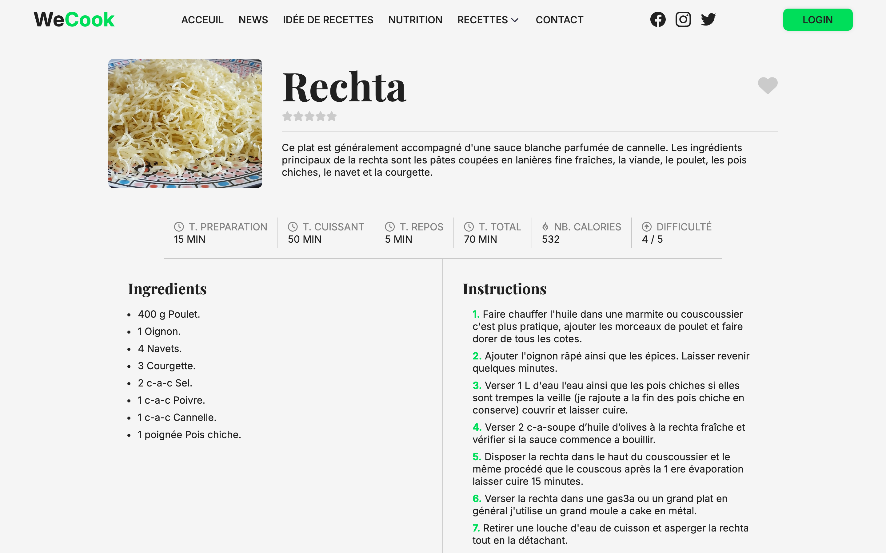
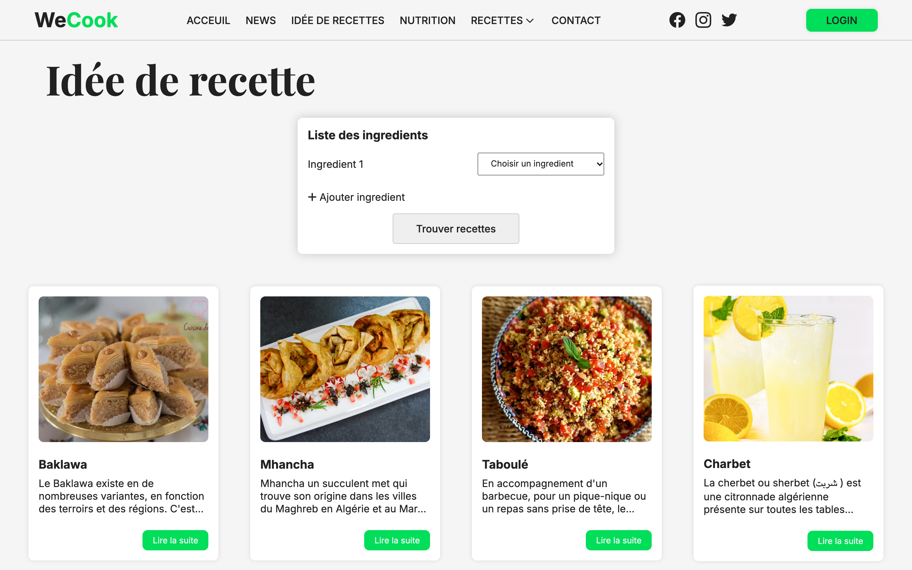
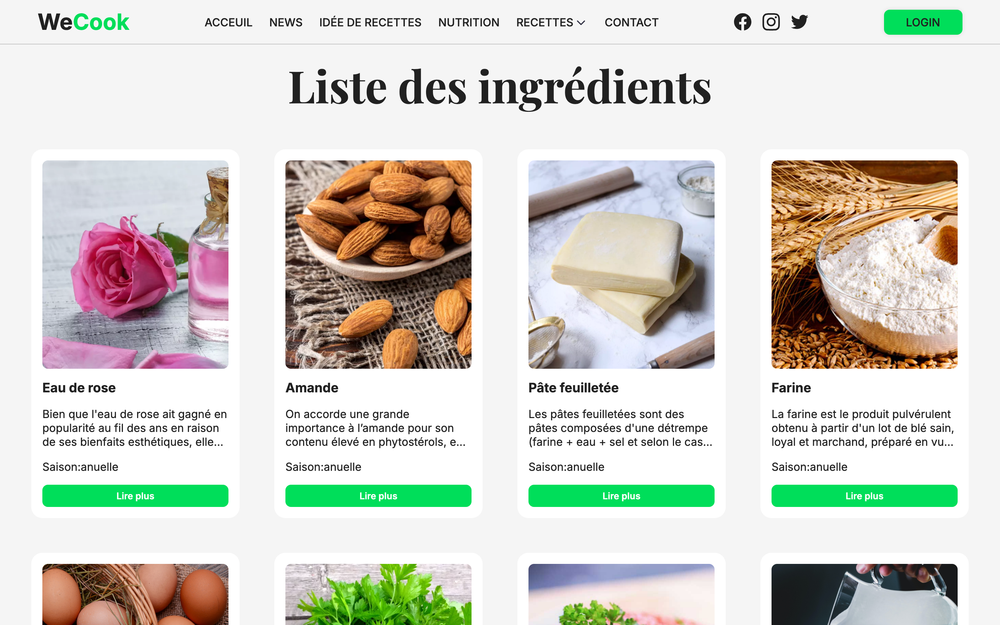
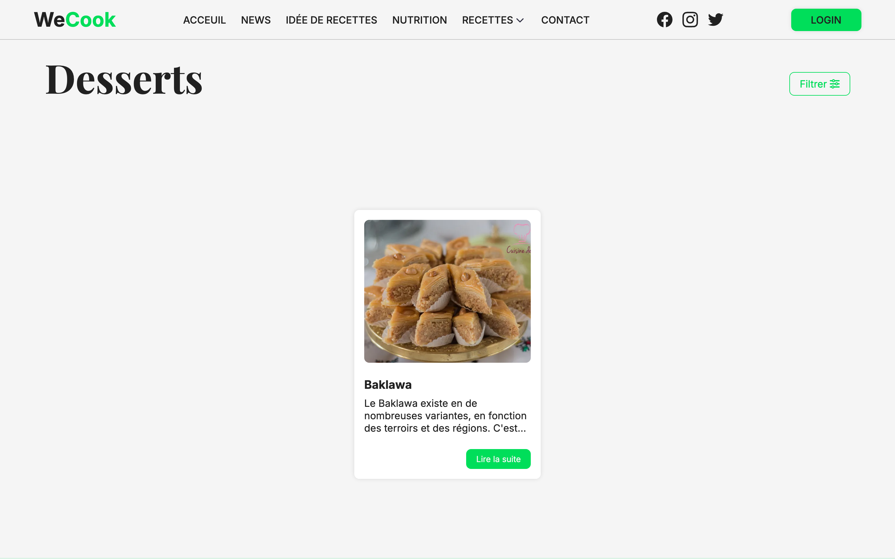
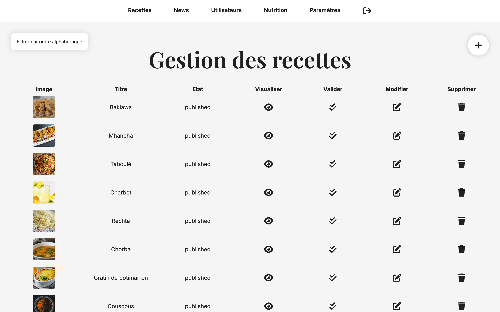

# WeCook

A recipe website with a full back office, written in plain PHP with a hand-rolled MVC framework (front controller, router, controllers, models, views) and MySQL. I built it alone for a web development course at ESI Algiers in January 2023.



| "Recipe idea": find recipes from the ingredients you have | Ingredients and nutrition |
|---|---|
|  |  |

| Recipes by category | Back office: recipe moderation |
|---|---|
|  |  |

*Captured in November 2026 by running the committed code and its SQL dump with `docker compose up`.*

## Features

**Visitors and members**
- Home page with a news slideshow and recipe rows by course (starters, mains, desserts, drinks), plus healthy, seasonal and festive collections.
- Recipe pages with preparation, cooking, resting and total times, calories, difficulty, ingredients, steps and star ratings.
- **Recipe idea:** pick the ingredients you have and get the recipes you can make.
- Nutrition pages for every ingredient, with seasonality.
- News articles, contact form, sign-up and login, a member dashboard, ratings, and recipe submission for members.

**Back office (`/admin`)**
- Recipe moderation: view, validate submitted recipes, edit, delete, sort.
- CRUD for news, ingredients and nutrition data; user management; site parameters such as the home slideshow.

## How it is built

- `public/index.php` and `admin/index.php` are front controllers; `.htaccess` rewrites every path to them and `App.php` maps `/controller/method/params` onto classes in `app/controllers`.
- Models share a `Database` trait (PDO with prepared statements) and a `Model` base with generic `findAll`, `where` and `insert` helpers.
- Views are PHP templates with shared header and footer partials; styling is hand-written CSS.
- `TDW.sql` is the full schema and seed data: recipes, ingredients, cooked-ingredient nutrition, steps, ratings, preferences, news, festivals and the slideshow.

## Running it

```bash
docker compose up        # then open http://localhost/Projet_Final/public/
```

The back office is at `http://localhost/Projet_Final/admin/` (seed account `admin` / `admin`). The site expects to live at `/Projet_Final`, as configured in `app/core/config.php`.

## Fixes made in November 2026

- The database connection string used `hostname=` instead of PDO's `host=` key, so PHP silently fell back to a local socket. It only worked on the original MAMP setup; it now connects anywhere.
- The admin login and logout redirects contained a literal `<?php echo ADMINROOT ?>` inside a string, which produced broken URLs.

## Limitations

- A course project, not production code: passwords, including the seeded admin's, are stored in plain text, and the admin password field is a text input.
- Desktop-first; recipe pages do not adapt to phone screens.
- URLs are absolute to `http://localhost/Projet_Final`.
